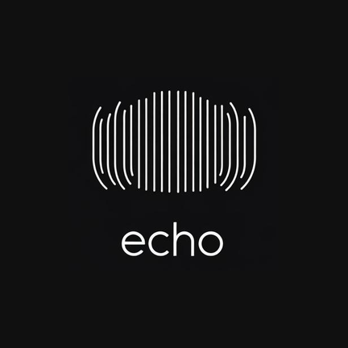

<p align="center">
  
</p>

<h1 align="center">Echo</h1>

<p align="center">
  <strong>A beautiful local music player for Android</strong><br/>
  Hi-res · Dolby Atmos · Android Auto · Lyrics · Listening stats
</p>

<p align="center">
  <a href="docs/index.html"></a>
  
  
  
</p>

---

## Why Echo?

Echo keeps your **own music library** first-class: FLAC and hi-res files, Atmos when the track supports it, a car-friendly Auto experience, and a player UI designed for listening—not ads.

| | |
|---|---|
| 🎧 **Hi-Res & lossless** | Clear badges for lossless / hi-res tracks |
| 🔊 **Dolby Atmos** | Detects Atmos / multichannel and bypasses processing for true spatial playback |
| 🚗 **Android Auto + Bluetooth** | Browse library in the car; AVRCP steering-wheel controls |
| 📝 **Synced lyrics** | Full-screen lyrics, select lines, share to Instagram Stories |
| 📊 **Stats & Wrapped** | Minutes listened (day / month / year) and shareable year Wrapped |
| 🖼️ **Artist photos** | Auto-fetched artist images with album-art fallback |
| 🎚️ **EQ & spatial** | Equalizer, remaster tools, immersive spatial modes |
| 🔒 **Lock screen & widgets** | Rich controls where you need them |

---

## Screenshots

> Add device screenshots under `docs/assets/` and link them here.

<p align="center">
  <em>Player · Library · Android Auto browse · Wrapped share cards</em>
</p>

---

## Android Auto

Echo registers as a **media app** for USB and wireless Android Auto:

```
Echo
 ├─ Recently played
 ├─ Most played
 ├─ Songs
 ├─ Albums → tracks
 ├─ Artists → tracks
 └─ Playlists → tracks
```

Bluetooth head units get **AVRCP** play / pause / next / previous, with audio routed to A2DP when connected.

---

## Stack

- **Kotlin** + **Jetpack Compose** (Material 3)
- **Media3** ExoPlayer + MediaLibraryService
- Coil for artwork
- Local MediaStore / SAF library scan

---

## Build

```bash
git clone https://github.com/YOUR_USER/Echo.git
cd Echo
```

1. Open the project in **Android Studio** (JDK 17+)
2. Sync Gradle
3. Run on a device or emulator
4. Grant **music** and **Bluetooth** permissions

---

## GitHub Pages

This repo includes a landing page in [`docs/`](docs/index.html).

**Enable Pages:** repo **Settings → Pages → Source: Deploy from a branch → `main` / `/docs`**.

Then open: `https://YOUR_USER.github.io/Echo/`

---

## Privacy

Echo is designed for **on-device** libraries. Artist photo and lyrics lookups use public APIs only when those features are used. No account required.

---

## License

Add your preferred license (e.g. MIT / Apache-2.0) in `LICENSE`.

---

<p align="center">
  <sub>Echo is not affiliated with Dolby Laboratories, Spotify, or Apple.</sub>
</p>
